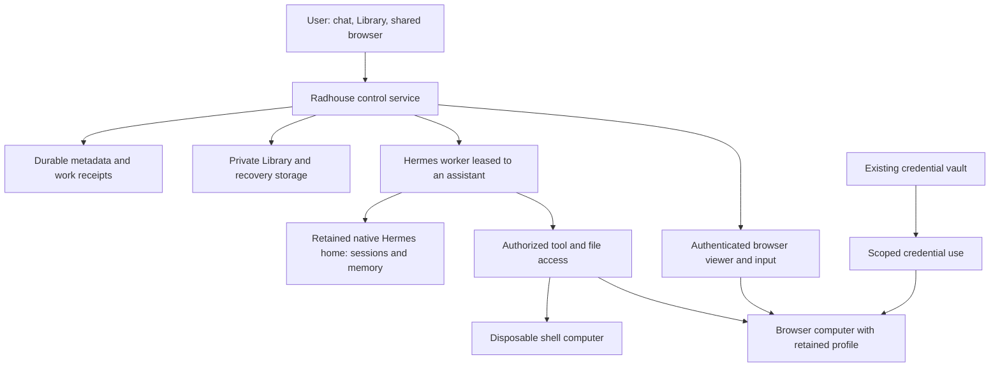

# Durable assistant workspaces and replaceable computers

Date: 2026-10-21. Updated: 2026-10-25. Status: target architecture with a deployed
browser-first and controlled worker-replacement slices; remaining changes require
implementation and qualification.
The accepted documentation boundary is
[ADR-0007](../decisions/0007-public-engineering-private-commercial-strategy.md).

Radhouse should keep the same assistant, conversation and Library while replacing
the compute used to do work. Preserve the current simple experience: open the
app, ask for something, use the shared browser when useful, and return later.
Users should not have to choose a VM, classify a download or manage checkpoints.

The [technical research](../research/space-and-durable-agent-workspaces.md)
records the inspected source baseline and public evidence. The
[development roadmap](../plans/2026-10-21-durable-workspace-roadmap.md) owns the
implementation sequence. The [Hermes implementation gap check](../research/hermes-continuity-gap-check.md)
maps existing code and pinned upstream capabilities to the remaining work.
The [SPACE browser slice](space-browser-pilot.md) is already qualified in the owner
pilot with local rollback. [Controlled worker replacement](controlled-worker-replacement.md)
now retains the current host's Hermes home, holds admission and packages recovery
using native export/import. On-demand worker placement, agent shell access and
durable browser profiles remain future capabilities.

## Target responsibilities

These are responsibilities, not a requirement for eight independently deployed
services. Initially retain one Radhouse web/control process, the current database
and file storage, and one qualified Hermes runtime. Add separation where the
authority or lifetime requires it. A text-only turn need not start any browser or
shell computer. A browser may remain open while its agent worker is idle.

The preferred target runs Hermes separately from its tool computers, through
qualified adapters. Running an entire Hermes instance in a per-workspace VM is a
valid transitional arrangement while storage attachment is implemented. It must still
externalize durable state and enforce task grants outside arbitrary guest code.
A VM snapshot of that instance is not sufficient application recovery on its own.

Reuse Hermes's existing persistent home, session loading and backup/import
facilities. Ordinary worker replacement attaches retained state; it does not
export/import an archive on every turn. Keep one gateway owner for an assistant's
home. A replacement must positively retire the previous owner before attaching
the home writable. Independent helpers use separate profiles and scoped inputs.
This is an integration task, not an experiment to discover whether Hermes can
remember or resume conversations.

## State ownership and storage

“Our database retains the assistant” means Radhouse controls durable storage and
recovery. It does not require putting large files, browser profiles and memory
snapshots into relational rows or recreating Hermes' memory system.

| State | Durable owner and location | Working copy and recovery |
| --- | --- | --- |
| Displayed chat, identities, file ownership, permissions and work receipts | Radhouse database outside worker VMs; keep SQLite for the single-process pilot | ChatStore already persists conversation/session mapping, turn/request/dispatch IDs, run status, grants and frozen inputs. Keep these identities; generic external-effect receipts and worker ownership are additional contracts, not existing guarantees. |
| Original uploads, completed downloads and accepted/generated files | Radhouse private file store; database holds owner, version, digest, provenance and visibility | Task copies are disposable. Publish immutable versions; acknowledge a save only after durable file and metadata commit. |
| Native agent session, memory, configuration and relevant local files | Retained Hermes home under Radhouse custody, separate from runtime releases | Hermes owns its state format and session loading. Preserve the session database, run-idempotency store, memories, configuration, skills and required local files. Reattach for ordinary replacement; use native backup/import for migration or disaster recovery. |
| Browser cookies, site storage, history and preferences | Separate private profile volume per workspace/browser identity | Attach to one browser generation at a time. Checkpoint consistently after stopping/quiescing Chromium; verify compatible restore. |
| Browser cache, temporary uploads and incomplete downloads | Temporary browser/task storage | Rebuild or reconcile after restart; these do not establish a durable Library save. |
| Saved credentials and encryption keys | Existing vault and separately controlled key custody | Exact-origin use through the qualified credential boundary; no bulk export to the model or shell guest. |
| Optional VM memory/disk snapshots | Protected infrastructure snapshot storage with version, owner and policy metadata | An acceleration/recovery aid. Recheck current authority before resuming; retained application files and receipts remain authoritative. |

For the first pilot implementation, place retained browser profiles and Hermes homes
in separate service-owned directories under the installation's private data root,
outside release trees and generation-temporary directories. Only the browser
service gets the browser profile. Only the owning runtime adapter gets writable
native state. The browser and shell do not mount the control database, the whole
Library or each other's data. Bind a lease to the workspace and generation before
attaching storage.

The recovery manifest records source/overlay pins, store locations, compatible
schemas, backup artifacts and exclusions. It does not invent another serialization
of Hermes memory or a per-turn copy of its databases. Native backup uses SQLite's
backup API; that supplies consistent individual databases, not an atomic snapshot
of Radhouse chat, files, native state and browser activity. For the first recovery
package, hold new dispatch and relevant writers while collecting a compatible set.
Keep the existing storage engines; no shared network SQLite or new database engine
is required for the single-owner implementation.

Full native archives contain credentials and exclude browser profiles and runtime
dependencies. Protect them as credentials, inspect skipped files, and keep the
qualified runtime image/source separately. Account for the existing native vault,
Radhouse browser-control store, Library originals and any configured external
memory-provider state explicitly. Never give a full home/archive to a shell helper.

Back up these retained stores to a separately protected destination; a directory
on the same host only proves process/VM replacement, not host-loss recovery.
Record which backup generations form a compatible recovery point and test their
restore. Protect profiles and snapshots at rest and in transit, with keys outside
arbitrary task guests. Deleting an account must retire live copies, grants and
retained backups according to a stated retention policy. Do not promise immediate
physical erasure of every backup if the implementation retains generations.

Browser sessions are credentials. While a browser is active it necessarily has
access to usable session state. Encryption at rest does not protect that state
from a compromised active browser or a sufficiently privileged operator. Guest
root can read what is inside its guest; this is a central reason to keep arbitrary
shell execution outside the browser computer.

## One Library and ordinary browser file handling

Use one product experience for files:

1. **Add a file:** upload to Library or attach it in chat. In a website's upload
   flow, the picker offers **Your device** and **Library**. A device upload is
   retained in Library as well as transferred to the chosen website.
2. **Download a file:** completed browser downloads appear in Library, whether
   initiated by the person or the assistant. Show saving/failure honestly; allow
   saving to the person's device from Library. Do not silently expire agent
   downloads while retaining human downloads.
3. **Use a file:** files shared with the assistant's workspace are available for
   authorized work. A task such as “upload this application to this portal”
   supplies file-and-destination intent; it should not produce repeated prompts
   for each transfer step. Reading a file does not grant permission to disclose
   it to another destination.

Implement transfers through a small owned bridge. It resolves opaque file IDs
against the authenticated workspace, checks task/browser generation and intended
destination, and stages only selected bytes. A browser tool must not accept an
arbitrary host path or unrestricted debugging connection. Downloads are received
in staging, checked for completion and size/resource safety, and committed to
Library before staging is retired. Make completion publication idempotent so a
reconnect cannot duplicate or lose an acknowledged save.

Run content validation and safe preview/extraction behind this experience. Treat
file bytes, names, archive contents and embedded instructions as untrusted
regardless of who clicked Download. Isolate parsers, refuse path traversal and
unsafe serving, and handle suspicious files with a clear explanation and recovery
action. Record origin and human/agent provenance for audit and troubleshooting;
neither is a safety rating. Retaining a file is distinct from executing it.

Private takeover remains meaningful. Transfers performed in **Private** stay
visible to the person in the same Library but do not silently enter assistant
context or assistant-readable grants. An explicit share or authorized task can
make them available. The UI needs a small private indicator and a Share action,
not a catalogue of upload/download types. A user-selected Library file can be
sent to a site during Private takeover without granting the agent access to the
private interaction. The transfer service enforces this independently of the
model and streaming viewer.

## Browser persistence and human control

The current generation-local profile is deleted on retirement. Replace that
behavior deliberately; retaining only a last-page locator or the chat database
does not retain logins. The first implementation should retain a consistent
profile volume across clean browser restarts. VM memory snapshots come later if
their measured resume benefit justifies the extra compatibility and secret
handling requirements.

Keep **Hide/Show**, **Take control**, **Private/Observe** and **Return to agent**
semantics. Ending a browser process should release compute while preserving its
profile. Add a separate explicit **Reset browser data** operation with a plain
explanation of sign-outs and history loss; do not overload Close with erasure.
Sites can expire/revoke sessions or require MFA despite successful persistence.

Private interaction must not enter agent screenshots, events, transcripts,
autocomplete context or background file grants. On handback, drain old input,
issue a fresh generation/lease and expose only the page the person deliberately
returns to the assistant. Do not replay a private navigation/event backlog. A
later shared page can still reveal actions made privately on that website; this
limitation must be explained without suggesting that Private undoes site effects.
Owner browser history can be retained without making it an automatic model input.

Do not automatically fork a logged-in browser profile for helpers. Retained
cookies can confer substantial account power even when password values remain
hidden. Allow one writer/controller per browser identity; helpers use independent
uncredentialed browsers or queue requests through the owning browser session.
Authenticated concurrent identities need separate explicit qualification.

Keep password saving in the existing vault. Before retaining Chromium profiles,
audit the current `basic` password-store configuration and disable browser-native
password saving/import on this path unless a separately qualified encrypted store
is deliberately selected. Do not infer that the current profile contains saved
passwords. Preserve exact-origin fill, human MFA, and secret-free tool results.

Optional **Bring your browser** onboarding can import supported bookmarks and
preferences, with a preview and rollback. Login and MFA may be required again.
Raw laptop-profile copying is not a reliable portable session migration because
of OS/application/device binding. Never bypass those protections or automatically
activate imported extensions. Handle any supported credential transfer through
the vault and explicit consent; erase temporary transfer packages. Initial use
must work without importing anything.

## Durable work and replaceable Hermes workers

The current chat lane already commits a request/dispatch identity and frozen input
before calling Hermes, attaches the returned run ID, polls its result, and preserves
ordered follow-ups. It calls the native Runs API with a stable session ID and
idempotency key. Hermes loads its transcript; Radhouse need not reconstruct it from
displayed chat. Retain the retry deadline and uncertainty behavior already present.

Build a small operator-controlled replacement path first:

1. Hold new dispatch, including the background observer's queued follow-ups. Drain
   active work through the native lifecycle; retain any interrupted/uncertain run
   and its original identity. The existing weekly-maintenance hold is specific to
   that workflow and is not a general replacement API.
2. Verify the old owner and its writers have stopped. Record the retained home's
   identity and compatible source/schema pins. Refuse a second writer or an
   incompatible successor; never restore over a live home.
3. Start the same qualified runtime/overlays against that home, retaining the
   stable authenticated service endpoint, session mappings and document callback
   configuration. Validate identity and required capabilities before releasing work.
4. Reconcile saved run status through the existing poll/retry path, then release
   the dispatch hold. Browser control must retire or rebind old generations rather
   than revive an obsolete viewer/input grant.

The initial acceptance check covers this new storage/lifecycle boundary with
synthetic state. Reuse existing chat restart, lost-acknowledgement, frozen-input and
queue tests. Add interrupted replacement, stale-owner and incompatible-state cases
where the new code introduces those paths. A general Hermes persistence benchmark
or new checkpoint engine is unnecessary.

Conversation resume and unfinished execution are different contracts. The pinned
Runs API can end a shutdown-interrupted run as `interrupted`; ChatService already
treats this as terminal. Do not automatically regenerate that run with a new key.
If later product work introduces automatic continuation, it needs explicit action
reconciliation. The first replacement slice can honestly retain an interrupted
result and allow a subsequent conversation turn. Current queued follow-up behavior
must be considered before releasing the hold, not silently changed by restoration.

For external effects, use provider idempotency keys and receipts where available.
If a process dies after an external action but before saving its receipt, do not
blindly retry. Reconcile with the destination or hold the operation with an honest
status. Exactly-once execution is not obtained by adding a queue or VM snapshot.
Revoke old leases before a restored copy receives tool access, and enforce current
policy outside the snapshot so old authorization cannot come back to life.

Future schedules require durable trigger IDs, admission and outcomes such as
completed-without-notification, not a fabricated chat reply for every wake-up.
Helpers receive bounded context, separate work directories and budgets. Their
results become proposed artifacts; the owning session serializes accepted memory
and conversation updates. Multiple workers must not concurrently mutate one
Hermes state directory. Model-provider capacity and quotas are separately bounded;
more microVMs do not create more inference capacity.

## SPACE and the security boundary

Add an execution adapter only for capabilities actually proven on its substrate:
create, readiness, execute, stream, stop, suspend/restore and cleanup. Negotiate
support; do not promise fork or draining on an adapter that lacks the required
durability. Keep the existing browser/native adapter until remote parity is proven.

The local worker currently authenticates Unix peers and assumes host-local
display/native transport. A remote adapter needs mutually authenticated service
transport, owner/run/generation checks, narrow browser/file APIs, and server-side
stream/input authorization. Do not expose Chromium debugging, arbitrary ports or
SPACE management APIs to a user's browser or the agent. Recheck authentication
on reconnect and invalidate old viewer/input endpoints on retirement.

SPACE should enforce supported network policy outside arbitrary shell guests.
Radhouse supplies workspace identity, allowed destinations, scoped file grants,
credential use, action authority and recovery. The shell gets task-selected files
and tool rights, not the browser profile, vault, host socket or control database.
Block unintended private-network and metadata-service access, exercise redirects
and DNS/shared-IP cases, and test effective policy again after restore. An allowed
website can still receive an unauthorized upload; network policy is one layer.

Use existing task intent and remembered scoped grants for ordinary work. Ask at
a meaningful boundary: newly exposing private data, an unapproved destination,
an account/financial consequence outside the task, or unresolved external effects.
Avoid confirmation for routine navigation, every local file read or every chunk
of an already authorized transfer. Preserve an audit trail and a usable revoke/
stop path without making the person administer infrastructure.

## Decisions to settle through implementation evidence

- Installation-specific store/key mapping and compatible recovery packaging using
  the supported native backup/import API; controlled exclusive home attachment.
- Profile encryption/key custody and backup-retention implementation for the
  pilot; measured acceptable recovery time and data-loss bound before activation.
- Further SPACE lifecycle/capacity qualification only for a capability being added;
  the accepted browser-first scope remains recorded separately. Memory snapshots
  are optional and do not block native-state recovery or retained browser profiles.
- Worker idle policy and resource savings after the replacement path exists.
- Any browser-import formats beyond bookmarks/preferences, based on supported
  migration rather than extraction of protected local sessions.

These are public technical decisions. Commercial packaging and investment
thresholds remain in the private commercial roadmap. No commercial decision is
required to establish a safe, usable public capability.
