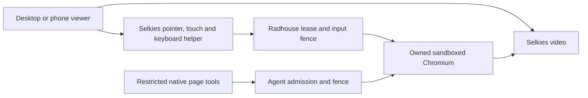

# Radhouse browser: Selkies desktop and mobile pilot

[ADR-0002](decisions/0002-selkies-browser-viewer.md) selects Selkies as the browser
viewer and human-input implementation. The current feature-branch deployment
is the unified disposable test browser. The existing production chat browser
is not yet connected to this separate pilot; chat integration must bind the
same principal, conversation, run and owned browser before replacing its panel.

## What is developed

- Continuous Selkies video and direct pointer/touch/keyboard input.
- Non-root sandboxed Chromium with public-web access and private-destination
  denial; public HTTP(S) downloads have no bandwidth or size cap.
- Durable human/agent control fencing, single-controller leases, held-input and
  clipboard cleanup, sensitive-field guard and fresh observation on return.
- A pinned native page-tool driver attached to the same Chromium; stable element
  references across tools and fresh attachment after human intervention.
- Bounded crashed-page checks, automatic generation/launcher recovery and
  container working-memory reclamation, including collection of unreachable
  page objects when browser pressure notifications alone are insufficient.
- One responsive viewer for desktop and mobile, using Selkies' existing mobile
  keyboard/IME helper, hardware-keyboard detection and fixed soft-key chords.

## Components and calls

The authenticated private launcher chooses capability, not device. A controlling
launch can request takeover on any device; a viewing-only launch cannot. Every
opened document has its own owner binding, and only one holds the input lease.
The server rejects expired/stale/viewer input even when a client modifies its UI.

The viewer's Keyboard button calls a small same-origin adapter synchronously
from the user's tap. The adapter focuses Selkies' `keyboard-input-assist` field;
Selkies' existing input handler translates composition and text into the guarded
stream. The hardware watcher runs inside the stream frame and exposes booleans,
not keys or text, to the outer UI. The Keys menu uses upstream `chordEvents`
for a fixed allowlist only. Dismissal, return, lost authority and unload clear
the local assist buffer. Keyboard events are not replayed after reconnect.

Touch/coarse-pointer state selects a compact layout. Hardware-keyboard detection
suppresses the main Keyboard button; Keys → Keyboard overrides that heuristic.
The available visual viewport controls local presentation when a soft keyboard
opens or the device rotates. The remote browser keeps its fixed resolution.

## Using the pilot

Open the deployment's `/browser` launcher after signing in to Radhouse. Existing
`/desktop` and `/phone` launcher URLs are aliases for that unified pilot.
`/view` is explicitly viewing-only; previously issued viewer credentials do not
gain control. Private host URLs and operational source/image hashes belong in
the Homelab deployment record, not this public guide.

Take control, tap the remote field and use Keyboard to type. The Keys menu
provides Keyboard override, Tab, Enter, Escape and Address bar. Return control
when finished. If a page check fails, reload the failed tab and retry return.
Phone keyboard/zoom controls remain local and do not alter input authority.

The profile is disposable; a service restart clears tabs/drafts and rotates
launch credentials. Reopen the launcher after restart. Test-driver observation
is not a production chat response. Existing login/secret-field handback rules
still apply. Closed shadow roots/custom secret widgets are outside the guard's
coverage; multiple visible browser windows remain unsupported.

## Next implementation boundary

Implement the accepted chat replacement by having the runtime bind Selkies to
its actual chat-owned browser and controller, then serve a conversation-bound
stream capability through app authentication. Replace legacy frame polling and
individual human-operation UI with that viewer. Keep native agent tools and
fresh handback admission on the same identity. This work must not substitute the
standalone test browser for the page the chat agent is using.

Build/source controls, sandbox requirements and focused test commands are in
[`runtime/selkies/README.md`](../runtime/selkies/README.md). The feature's draft PR
and the private Homelab change record own the current deployment evidence.
