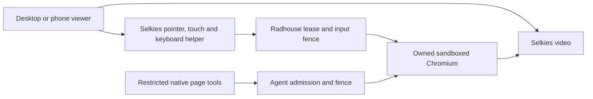

# Radhouse browser: Selkies desktop and mobile pilot

[ADR-0002](decisions/0002-selkies-browser-viewer.md) selects Selkies as the browser
viewer and human-input implementation. The current feature-branch deployment
is the unified disposable test browser. The existing production chat browser
is not yet connected to this separate pilot; chat integration must bind the
same principal, conversation, run and owned browser before replacing its panel.

## What is developed

- Continuous Selkies video and direct pointer/touch/keyboard input.
- Non-root sandboxed Chromium with public-web access and private-destination
  denial; public HTTP(S) downloads have no bandwidth or size cap.
- Durable human/agent control fencing, single-controller leases, held-input and
  clipboard cleanup, sensitive-field guard and fresh observation on return.
- A pinned native page-tool driver attached to the same Chromium; stable element
  references across tools and fresh attachment after human intervention.
- Bounded crashed-page checks, automatic generation/launcher recovery and
  container working-memory reclamation, including collection of unreachable
  page objects when browser pressure notifications alone are insufficient.
- One responsive viewer for desktop and mobile, using Selkies' existing mobile
  keyboard/IME helper, hardware-keyboard detection and fixed soft-key chords.

## Components and calls

The authenticated private launcher chooses capability, not device. A controlling
launch can request takeover on any device; a viewing-only launch cannot. Every
opened document has its own owner binding, and only one holds the input lease.
The server rejects expired/stale/viewer input even when a client modifies its UI.

The viewer's Keyboard button calls a small same-origin adapter synchronously
from the user's tap. The adapter focuses Selkies' `keyboard-input-assist` field;
Selkies' existing input handler translates composition and text into the guarded
stream. The hardware watcher runs inside the stream frame and exposes booleans,
not keys or text, to the outer UI. The Keys menu uses upstream `chordEvents`
for a fixed allowlist only. Dismissal, return, lost authority and unload clear
the local assist buffer. Keyboard events are not replayed after reconnect.

Touch/coarse-pointer state selects a compact layout. Hardware-keyboard detection
suppresses the main Keyboard button; Keys → Keyboard overrides that heuristic.
The Keys button opens an inline panel across the toolbar width. Mobile controls
use a three-column grid with 44px minimum targets; every key stays within the
pane instead of overflowing from the toggle. Empty notices take no space.
The remaining visual viewport, including the actual hint height, controls local
presentation when a soft keyboard opens or the device rotates. Short screens
can scroll to reach the controls. The remote browser keeps its fixed resolution.

## Using the pilot

Open the deployment's `/browser` launcher after signing in to Radhouse. Existing
`/desktop` and `/phone` launcher URLs are aliases for that unified pilot.
`/view` is explicitly viewing-only; previously issued viewer credentials do not
gain control. Private host URLs and operational source/image hashes belong in
the Homelab deployment record, not this public guide.

Take control, tap the remote field and use Keyboard to type. The Keys menu
provides Keyboard override, Tab, Enter, Escape and Address bar. Return control
when finished. If a page check fails, reload the failed tab and retry return.
Phone keyboard/zoom controls remain local and do not alter input authority.

The profile is disposable; a service restart clears tabs/drafts and rotates
launch credentials. Reopen the launcher after restart. Test-driver observation
is not a production chat response. Existing login/secret-field handback rules
still apply. Closed shadow roots/custom secret widgets are outside the guard's
coverage; multiple visible browser windows remain unsupported.

## Current pilot acceptance

The installed unified viewer passed all 13 desktop stream journeys and seven
focused mobile checks: takeover, ASCII text/preedit replacement/deletion,
hardware-keyboard override, navigation soft keys, orientation, handback cleanup
and viewing-only input denial. Desktop emulation verifies the existing assist
focus and remote values. The owner confirmed iPhone keyboard input works and
reported clipped keys; the responsive correction passed eight viewport/text-size
cases, including 320px width, landscape and a short viewport. Android keyboard
appearance and the updated layout on a physical phone remain owner acceptance.

Non-ASCII text is a known pilot limitation. The accented-character and CJK
probes failed: events reached the synthetic page, but Chromium reported null
characters instead of text after dynamic X11 keymap binding. Repeating a binding
and using the existing Selkies text-commit protocol did not fix it. The fault is
not yet isolated within the X11/Chromium mapping path. The mobile pilot therefore
has verified ASCII typing only; full international text acceptance is open.
No alternate text-injection or clipboard workaround is installed.

## Next implementation boundary

Implement the accepted chat replacement by having the runtime bind Selkies to
its actual chat-owned browser and controller, then serve a conversation-bound
stream capability through app authentication. Replace legacy frame polling and
individual human-operation UI with that viewer. Keep native agent tools and
fresh handback admission on the same identity. This work must not substitute the
standalone test browser for the page the chat agent is using.

Build/source controls, sandbox requirements and focused test commands are in
[`runtime/selkies/README.md`](../runtime/selkies/README.md). The feature's draft PR
and the private Homelab change record own the current deployment evidence.

## Integrated platform workspace

The platform replacement keeps Hermes' conversation-owned browser and controller.
An embedded Selkies adapter provides its live display and human input over an
authenticated HTTP/WebSocket relay. No second browser is substituted for agent
work. Selkies is installed as a frozen package outside Hermes' existing Python
environment; existing dependency versions remain authoritative. Private X11
authentication, a renderer sandbox proof and the existing public-web firewall
remain required. Closed broad desktop/file/command APIs are not exposed.

Chat displays a small live browser while an agent browser step or human takeover
is active. Select that preview for Browser emphasis; Back to chat restores chat
emphasis without moving the stream or losing the draft. Desktop retains chat
alongside Browser. On phones the Chat button opens a compact drawer; switching
focus hides the remote keyboard assist. Keys uses an inline grid with at least
44-pixel targets. Browser mode compacts the phone header to preserve vertical
space; the normal Chat header remains. Fit and Zoom change local presentation only.

Take control privately is the default. Private blocks model page reads and
mutations; chat attaches neither the current nor previous page. Select Let agent
observe to allow read-only page snapshots when you ask in chat. You retain mouse
and keyboard control. Select Private again before entering sensitive information
and wait for confirmation. The server revokes the observation epoch, waits for
the shared observation boundary and discards pending captures before confirming.
Already delivered observations cannot be removed from the agent's conversation.
No keystroke recording, persistent walkthrough or model training is added.

Minimizing or opening chat never returns control. Return to agent explicitly
revokes human input, releases held input, clears the clipboard, checks sensitive
fields and obtains a fresh observation before admitting a new agent run. Submit
or clear passwords and one-time codes before return. Logout, expiry and a lost
controlling stream revoke input; reconnect does not replay keyboard events.
The original saved login vault remains separate from the browser profile.

The standalone pilot and integrated platform are distinct deployments; installation
and logged-in acceptance are recorded in the Homelab change record. Physical
iPhone/Android layout acceptance and non-ASCII text remain separate limitations
from automated responsive and ASCII checks.

## Phone playback and moving between devices

If inline video needs a gesture, select **Tap to view browser**. This starts
local video playback only; it does not take control or send a click to the remote
page. The viewer reports Live only after frames are presented. Silent inline
video is requested, with an explicit tap fallback for browser playback policies
([WebKit policy](https://webkit.org/blog/6784/new-video-policies-for-ios/)).

If another signed-in tab holds the browser, select **Move control here**. This
explicitly revokes that tab, waits for pending input and observations, releases
held input and clears clipboard state, then starts a fresh **Private** takeover
here. The previous tab becomes viewing-only. Neither a playback tap nor merely
opening the Browser tab transfers control. Use **Let agent observe** again only
when you want requested read-only page observations on this device. A lost or
unconfirmed move is not automatically retried.
