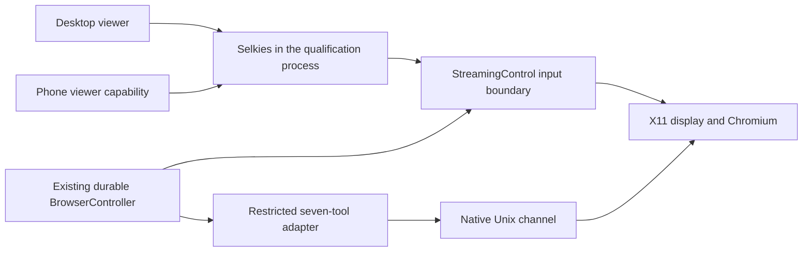

# Selkies browser qualification

This package runs a disposable Radhouse browser review: desktop takeover and
phone viewing, using one sandboxed headed Chromium and the reviewed native driver. A
deterministic test driver invokes the same seven-tool map and Unix channel used
by Hermes. No model request or production conversation is used. The review has its own
disposable profile. Public websites are available when the deployment enables
`RADHOUSE_BROWSER_MODE=public_web` with `RADHOUSE_REVIEW_PROXY`.

`source-lock.json` freezes the upstream source, native driver, Chromium and Linux
base. `requirements.txt` pins the resolved Python dependencies. `prepare.py`
verifies native/source identity, builds the locked upstream client, records the
actual served bundle and candidate source hashes, and retains the modified
MPL client sources and notices in the image. The upstream gamepad postbuild is
excluded because it downloads a moving database outside this candidate's scope.

## Control and input



Phone capabilities cannot obtain an input grant, call agent tools, or acquire a
desktop capability. Each desktop document, including a reload or duplicated tab, gets a distinct owner binding. Closed idle sessions are reclaimed at the bounded viewer limit; launch capabilities, connected streams and the current holder remain protected. Takeover
closes agent admission, waits for an in-flight native action and its matching
fence, then issues a new stream credential. Credentials travel in the iframe
fragment; a public connection nonce forces the iframe to reload on authority
changes. A fragment change alone would leave the old connection running.

Every human input is checked against the current generation and live durable
lease inside an input lock. The sole display is fixed at 1280×900; viewer resize
and phone orientation change local presentation only. General file, recording,
terminal, media, settings and alternative input APIs are denied by the server.
Trusted internal punctuation commits remain inside their admitted operation.
Background key injection and the synchronous X11 repeat path obey the same
lease fence, including expiry and stale generations.

Handback first checks password/code fields while input is fenced. Explicit agent snapshots use the same guard. Checks run in an isolated JavaScript world and inspect child frames, out-of-process frames and open shadow roots, returning only a boolean. A page cannot replace the guard’s DOM methods through its main-world scripts. Closed shadow roots and arbitrary custom secret widgets are outside this guard’s coverage. A verified
sensitive-field rejection keeps human control so the owner can finish sign-in.
After revocation, it releases held input, synchronizes the injecting X
connection, verifies physical key/button state, clears and verifies CLIPBOARD
and PRIMARY ownership, and obtains a fresh native observation before admitting
a fresh agent run. `HumanReturnObservation` is a private typed proof bound to
the exact owner, generation and paused revision; ordinary paused-run admission
remains denied. Unconfirmed boundaries stay paused. Input is never replayed.

The client adaptation disables initial/focus clipboard reads and enables the
upstream deliberate copy/paste gestures for Chromium collaborators. The
server's background clipboard monitor is disabled. Clipboard reads are explicit
and confined to the controlling connection. No clipboard payload or input text
is forwarded to the outer UI's status bridge or collected by diagnostics.

## Build and run

Supply the frozen upstream archive and the qualified driver/Chromium artifacts
from an authorized installation or retained build. The preparation rejects
different native executable bytes. Keep output and credentials outside public
Git.

```sh
python3 runtime/selkies/prepare.py \
  --archive /path/to/frozen-selkies.tar.gz \
  --native /path/to/qualified-agent-browser \
  --chromium-archive /path/to/chrome-linux64.tar.gz \
  --output /private/tmp/radhouse-selkies-build
docker build --platform linux/amd64 \
  -t radhouse-selkies-qualification /private/tmp/radhouse-selkies-build
docker run -d --platform linux/amd64 \
  --name radhouse-selkies-qualification --shm-size 2g \
  --security-opt seccomp=/path/to/qualified-chromium-seccomp.json \
  --security-opt apparmor=radhouse-selkies-web \
  -p 127.0.0.1:18080:8080 radhouse-selkies-qualification
docker cp radhouse-selkies-qualification:/state/viewer-links.json /private/tmp/viewer-links.json
chmod 600 /private/tmp/viewer-links.json
```

The private links identify the desktop and phone viewing capabilities. Each
start uses a fresh display, native session and controller store; viewer reload
and reconnect preserve the running browser, while a container restart creates
a new disposable browser. Loss of the owned Chromium process or the revocation watcher terminates the service so its deployment can restart a fresh generation. Private launchers must refresh their capabilities after generation changes. Failures are diagnosed and corrected, followed by a
new qualified candidate; no rollback operation is implemented.

Chromium is launched directly as the unprivileged review user, then the unchanged
reviewed native driver attaches through its private local path. This avoids the
driver's container heuristic that automatically disables the sandbox. Startup
requires owned non-root renderers with an extra PID namespace/BPF filter and no
sandbox-disabling flags; installed verification also proves distinct user and
network namespace inodes. The container needs the qualified per-container
seccomp/AppArmor policies from its private deployment; there is no unsandboxed
fallback. Host sysctls and general Docker policy remain unchanged.

The public-only HTTP/CONNECT proxy runs separately without TLS termination or
payload logging. It accepts only the configured browser address, resolves IPv4,
rejects any non-global/multicast/reserved DNS result, and connects to the exact
vetted numeric address on ports 80/443. The browser stays on an internal network
without a default gateway. Implicit loopback bypass is removed before the narrow
fixture exception is added. HTTPS certificates remain browser-verified end to
end. Host policies and private launch links belong in the Homelab change record.

A trusted visibility boolean aligns observations with exactly one visible
Chrome page through the same native command queue. This tab-selection capability
is private and is not added to the seven agent tools. Multiple visible browser
windows remain an unconfirmed boundary rather than choosing an arbitrary page.

## Validation

The pure adapter tests use the actual durable controller and cover phone denial
with a desktop positive control, native in-flight takeover, competing tabs,
expiry, replacement generations, input draining, privacy preconditions and
failure without agent admission.

```sh
PYTHONPATH=src python -m pytest -q \
  tests/test_selkies_control.py tests/test_browser_control.py \
  tests/test_native_control.py tests/test_hermes_browser_sessions.py
RADHOUSE_PLAYWRIGHT_MODULE=/path/to/@playwright/test/index.mjs \
RADHOUSE_SELKIES_LINKS=/private/tmp/viewer-links.json \
RADHOUSE_SELKIES_CONTAINER=radhouse-selkies-qualification \
RADHOUSE_SELKIES_OUTPUT=/private/tmp/radhouse-selkies-evidence \
node tests/selkies-browser.mjs
```

The live journey also supports private HTTPS review endpoints: fabricated
phone and stale-client checks select WSS when the page uses HTTPS.
`tests/selkies-security.mjs` adds synthetic isolated-world, framed-field, copied-tab and idle-session regressions using the same environment variables. Fixture mode includes out-of-process frame checks. Set
`RADHOUSE_SELKIES_ENVIRONMENT` to describe the measured deployment accurately.
Host configuration, authenticated launchers and deployment receipts belong in
the private Homelab change record.

The live browser journey performs input through the real Selkies stream.
Loopback fixture telemetry supplies geometry and assertions, never the input.
It checks desktop typing, Mac shortcuts and deliberate paste, chat focus,
competing tabs, fabricated valid phone input, local phone zoom/orientation,
synthetic private sign-in, held-key handback, fresh native observation, stale
credentials and viewer reload. Public mode also checks address-bar HTTPS
navigation and handback from a manually opened visible tab. Each run opens a
fresh exercise page; report ordering preserves its newest field state. Screenshots and bounded JSON results remain
private. Emulation is not real-phone or physical-keyboard acceptance.
The fixture's binary visual marker also measures pointer input to the decoded
and presented frame using one client-side performance clock. This traverses
input, the remote page, capture, encoding, transport and client presentation;
it is not a CDP timing proxy or a physical key-to-screen measurement.

Before production application activation, broaden multi-window/tab agreement,
queued input and renderer scheduling, repeated reconnects and
service failures, authentication/logout expiry, actual HTTPS embedding,
input-to-visible latency and resource use, then conduct owner device acceptance.
Resource qualification must include sustained public downloads and post-load observation. Check cgroup `memory.events` and renderer survival; a child renderer can be OOM-killed while the stream and container remain alive. The public proxy applies connection bounds, without bandwidth shaping.
The controller extension is implemented; the production web/runtime wiring and
paired installed-release qualification remain the next integration slice.
